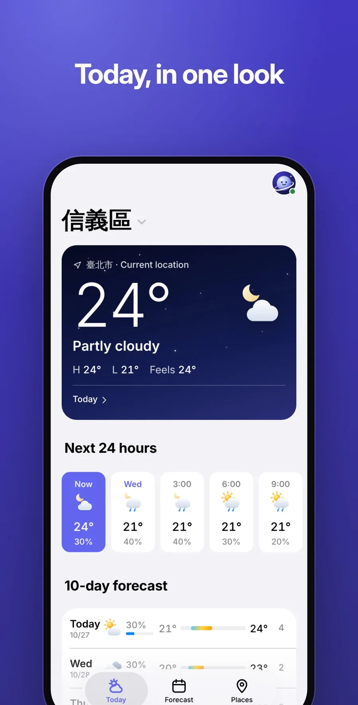
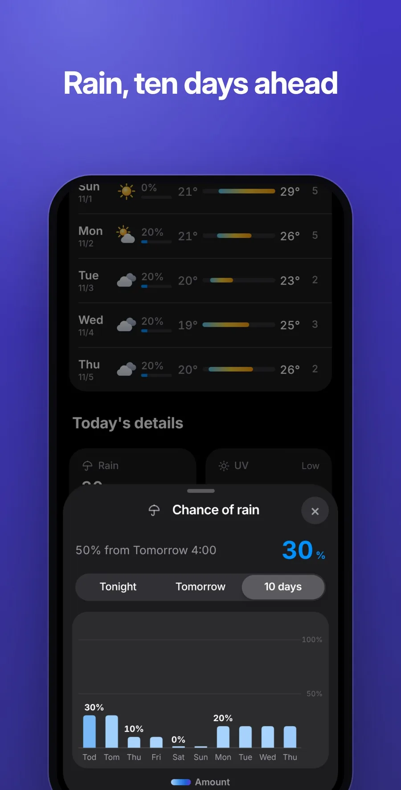
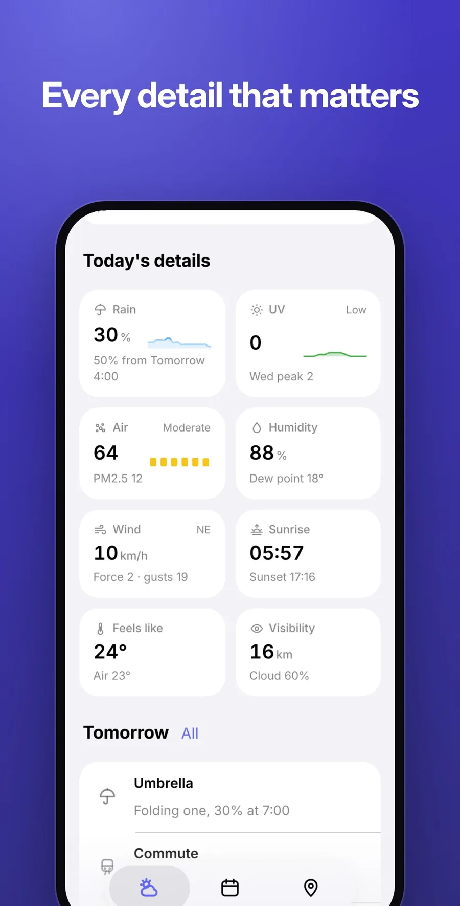

<p align="center">
  
</p>

<h1 align="center">Orbit Weather</h1>

<p align="center">
  <b>One clear forecast.</b><br>
  <a href="https://jaypengx.com/weather/"><b>jaypengx.com/weather</b></a>
</p>

<p align="center">
      
</p>

One forecast for where you are and the places you pin, down to the township. Part of **Orbit**, a family of phone apps for life in Taiwan that share one sign-in, the Orbit Pass. See them all at [jaypengx.com](https://jaypengx.com/).

<p align="center">
  
  
  
</p>

## Features

- **One answer:** Google Weather, CWA 中央氣象署, MOENV 環境部 and real station readings blended into one value per thing; the app never names a source.
- **Today:** the sky now, the next 24 hours and what to wear or bring.
- **Forecast:** rain, UV and air quality, each with day tabs and graphs, humidity, wind, and 10 days ahead.
- **Rain soon:** one line when rain starts or eases within two hours.
- **Your day (我的行程):** each hour shows the forecast for where you'll be then, from your pinned places.
- **Typhoon days:** while a warning is out, the county's 停班停課 decision, or the chance of a day off fitted to past decisions.
- **Notices:** the morning brief at your time, and a rain watch from 07:00 to 21:00.
- **Opens at once** on the last forecast kept, then refreshes behind it.

## Tech stack

| Layer | What |
| --- | --- |
| App | Plain JavaScript (ES modules), HTML and CSS; no framework, no build step, no dependencies |
| Platform | Installable web app with a service worker; works offline on the last forecast |
| Shared | Look, Orbit Pass (which keeps the pins), notices from the kit in [Shared-Proxy](https://github.com/JayPengX/Shared-Proxy) |
| Data | The proxy's `/weather` (Cloudflare Workers): Google Weather + CWA + MOENV + stations, blended and kept 15 minutes per ~1 km cell in KV; it learns which source to trust |
| Graphics | The app draws its own icons and graphs; no emoji (a test checks) |
| Tests | `node --test` |

## How it works

```
phone position (Wi-Fi fix, then GPS)
   ▼
GET api.jaypengx.com/weather?lat=&lon=   ── Google · CWA · MOENV · stations
   ▼                                        blended per ~1 km cell (weather.js, weather-skill.js)
one value per thing ─► 今天 · 預報 · 地點
```

- **One number means one thing everywhere:** the line, the graph and the 10-day row read the same hours.
- **Fresh, never stale as now:** asked again once 15 minutes old; an older forecast is faded and hidden after 6 hours.
- **Pins** carry days and hours, so the app opens on school during school hours.

Details and the decisions still in force: **[MAP.md](MAP.md)**.

## Project structure

```
public/
├── index.html, app.mjs, weather.css   the page and its flow
├── lib/
│   ├── api.mjs          the proxy, the position, this device's copies
│   ├── cards.mjs        the three tabs and their sheets
│   ├── graph.mjs        every graph
│   ├── pins.mjs, plan.mjs, soon.mjs   pins, 我的行程, rain soon
│   ├── format.mjs, sun.mjs, icons.mjs labels and colours, sunrise, pictures
│   └── advice-en.mjs    English
└── sw.js
tests/                   node --test (with saved forecasts)
MAP.md                   how it works
```

## Getting started

The app loads the shared kit from a sibling folder, so clone this repo next to [Shared-Proxy](https://github.com/JayPengX/Shared-Proxy):

```bash
git clone https://github.com/JayPengX/Shared-Proxy.git
git clone https://github.com/JayPengX/Orbit-Weather.git
cd Orbit-Weather
```

Requirements: Node.js 22 or newer. There is nothing to install: no framework, no `node_modules`.

```bash
npm test   # links ../Shared-Proxy/kit as .kit, then runs node --test
```

See it on a phone-sized screen, signed in with a made-up wallet and real data (needs Playwright):

```bash
# a screenshot, saved in /tmp/orbit-preview
node ../Shared-Proxy/tools/preview.mjs weather --live --width 375
# serve it, then open http://localhost:8123/Orbit-Weather/
node ../Shared-Proxy/tools/preview.mjs weather --live --serve --port 8123
```

`--dark`, `--lang en`, `--webkit` (Safari's engine) and the other flags are listed in [Shared-Proxy/tools/README.md](https://github.com/JayPengX/Shared-Proxy/blob/main/tools/README.md).

Without `--live`, the preview uses saved forecasts for Taipei 101 (`--no-geo` refuses the position).

## Deploying

Push to `main`. GitHub Actions runs the tests, stamps every file with its content hash (so a phone downloads only what changed) and publishes `public/` to GitHub Pages; the site Worker serves it at its jaypengx.com address. There are no pull requests or release branches.

## Part of Orbit

| App | What it is |
| --- | --- |
| [Orbit Sports](https://github.com/JayPengX/Orbit-Sports) | Every game you can watch in Taiwan, live |
| [Orbit Transit](https://github.com/JayPengX/Orbit-Transit) | Bus, train, metro and YouBike, planned and navigated |
| [Orbit Weather](https://github.com/JayPengX/Orbit-Weather) | One clear forecast, to the township |
| [Orbit Words](https://github.com/JayPengX/Orbit-Words) | English vocabulary that stays |
| [Orbit Securities](https://github.com/JayPengX/Orbit-Securities) | A Taiwan broker on play money |
| [Orbit Class](https://github.com/JayPengX/Orbit-Class) | Today's classes at a glance |
| [Orbit Beats](https://github.com/JayPengX/Orbit-Beats) | Endless music and your own beats |
| [Orbit Law](https://github.com/JayPengX/Orbit-Law) | Laws, rulings and bills, linked |
| [Orbit Money](https://github.com/JayPengX/Orbit-Money) | Your own books |
| [Shared-Proxy](https://github.com/JayPengX/Shared-Proxy) | The kit, the Orbit Pass and the Workers behind them all |

How it was all built, in pictures and numbers: [jaypengx.com/showcase](https://jaypengx.com/showcase/).
